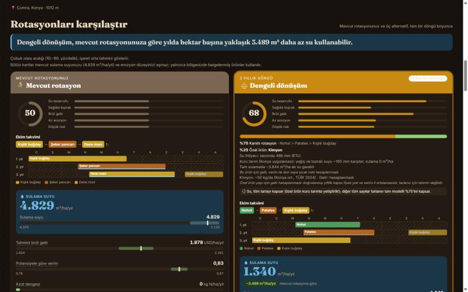

# Rotacast

**Rotacast shows a farmer what their own field has been through and which crop rotation fits a drier, hotter future.**
Pick a field in Konya and Rotacast reads 25 years of NASA satellite and weather data, remembers how the field behaved
(NDVI "Field Memory"), simulates dozens of rotations against real historical weather, and shows three strategy cards
(balanced transition, low risk and resilient, innovative crop opportunity) with uncertainty bands and plain-language
reasons. Only crops documented in the field's agro-climate zone by an official source are used, and no card may use
more irrigation water or cause more erosion than the current rotation. A Basin View scales the engine to the Konya
Closed Basin and compares water-focused adoption scenarios with the GRACE groundwater-storage decline. Built for the NASA
Space Apps 2026 challenge "Field Shift: Adapting Farms with NASA Data".


<!-- TODO: add docs/screenshot.png (field analysis view and Basin View) -->

## Features

- **Field analysis** for any lat/lon: climate shift (1991 to last year, Sen slope + Mann-Kendall), FAO-56 ET0 and aridity.
- **Field Memory** from MODIS NDVI: crop pattern per year, green-up/senescence, bare-soil windows, stress years.
- **Rain bias correction**: NASA POWER rain rescaled monthly to CHIRPS (Cumra: 533 to 302 mm/yr).
- **Rotation engine**: seeded candidate generation (agronomic rules, legumes, cover crops), FAO-56 daily water balance, 21-crop knowledge base.
- **Konya zones**: 7 agro-microclimate zones (MGM 1991–2020 classifications, NASA POWER frost climatology) with a
  manually verified crop whitelist per zone (verified / pilot / do-not-expand), each crop linked to its source.
- **Strategy cards**: whitelist-only rotations within hard water and erosion limits, split fields with a specialty
  crop share, official pilot crops as trial rows; p10/p50/p90 from 20 historical start years.
- **Basin View (Konya)**: 19 POWER cells, MODIS cropland, calibrated irrigated baseline, adoption scenarios, GRACE comparison.
- **Evidence trail**: every fact in a report links to a source id; assumptions and limitations are listed in the report.
- Turkish and English UI.

## Quickstart

Requires Python 3.11+ and Node 20+.

```bash
# backend
pip install -r backend/requirements.txt
uvicorn rotacast.api.main:app --app-dir backend        # http://localhost:8000

# frontend
cd frontend
npm install
npm run build        # type-check + build into frontend/dist (served by the backend at /)
# or, for development with hot reload (proxies /api to localhost:8000):
npm run dev          # http://localhost:5173
```

Endpoints: `POST /api/field/analyze`, `GET /api/basin/konya`, `GET /api/crops`, `GET /api/health`.
Tests: `cd backend && pytest`.

### Offline mode

```bash
ROTACAST_OFFLINE=1 uvicorn rotacast.api.main:app --app-dir backend     # PowerShell: $env:ROTACAST_OFFLINE = "1"
```

With `ROTACAST_OFFLINE=1` no connector touches the network; responses come from `data/cache/` and a missing entry fails
with a cache miss. `backend/scripts/check_offline.py` verifies that the Konya demo report can be built offline.
The precomputed Basin View report is served from `data/demo/basin_report_konya.json`.

## Repository layout

```
backend/rotacast/
  connectors/   NASA POWER, MODIS (NDVI, land cover), CHIRPS/IMERG, SoilGrids, terrain tiles, GRACE, cache
  engine/       climate (ET0, shift), phenology (Field Memory), waterbalance, rotations, scoring
  knowledge/    crops.yaml (21 crops, sourced)
  report.py     field report builder    regional.py   Basin View scaling
  api/          FastAPI app
backend/scripts/ build demo / basin reports, offline check     backend/tests/ pytest suite
frontend/       React + Vite + MapLibre + ECharts UI
data/           cache/ (API responses) and demo/ (prebuilt reports)
docs/           PLAN, CONTRACTS, METHODS, SOURCES, STATUS
```

## Methods

How it works, with equations and an honest limitations section: [docs/METHODS.md](docs/METHODS.md).
Rotacast gives decision support for a scenario, not forecasts or agronomic advice.

## Data sources

NASA POWER, MODIS MOD13Q1 and MCD12Q1, GRACE/GRACE-FO (CSR mascons), GPM IMERG, SRTM terrain tiles, with CHIRPS (UCSB),
ISRIC SoilGrids, FAO-56/33/66, FAO ECOCROP, FAOSTAT, TUIK and TMO as supporting references. Full citations, licenses and
URLs: [docs/SOURCES.md](docs/SOURCES.md).

## Use of SI (AI) tools

This project was built with Claude Code (Anthropic) as a coding assistant, used for code generation, documentation and
review, and for literature searches. Humans set the design and direction, chose the data sources and methods, and
verified the results; the zone crop whitelist was verified manually against official sources by the team. Details in
the SI tools section of [docs/SOURCES.md](docs/SOURCES.md).

## License

MIT, see [LICENSE](LICENSE).
